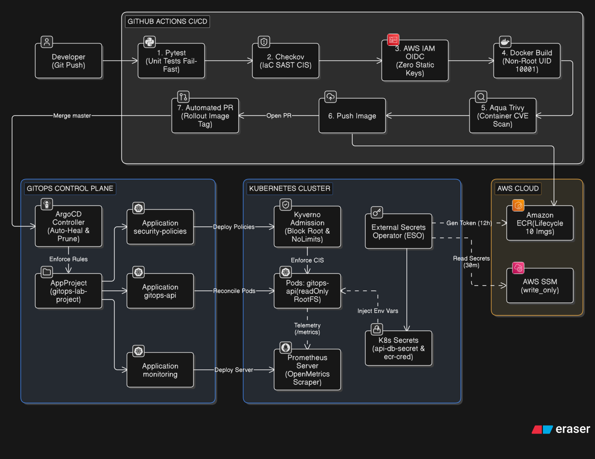
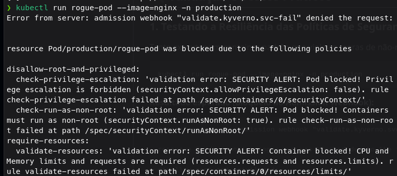
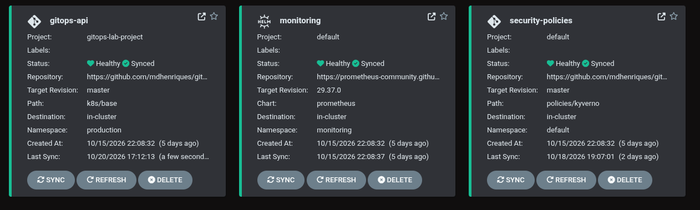
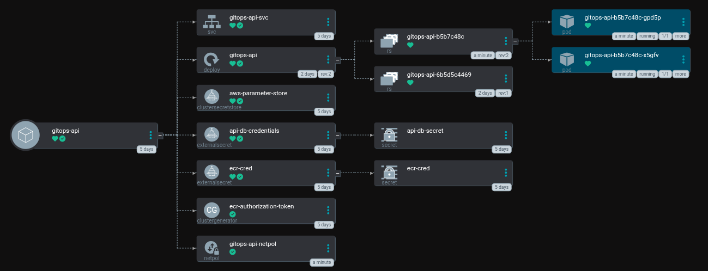
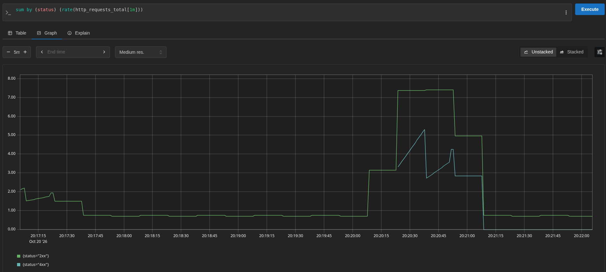

# Enterprise GitOps & DevSecOps Cloud Platform

[](https://github.com/mdhenriques/gitops-lab/actions/workflows/deploy.yaml)
[](LICENSE)
[](https://kubernetes.io)
[](https://www.terraform.io)
[](https://aws.amazon.com)

Ambiente completo de entrega contínua (**GitOps**) e segurança integrada (**DevSecOps**), desenhado seguindo os princípios de menor privilégio, segredos efêmeros, imutabilidade de imagens, governança de multi-tenancy e validação contínua de políticas de admissão (*Policy-as-Code*).

---

## 🏛️ Arquitetura da Solução

O fluxo conecta a nuvem pública (**AWS**), esteiras de automação com shift-left security (**GitHub Actions**) e orquestração de containers com governança (**Kubernetes & ArgoCD**):

<p align="center">
  
</p>


---

## 💡 Decisões de Engenharia & Diferenciais de Segurança

| Domínio | Abordagem Tradicional (Anti-padrão) | Abordagem Deste Projeto (Padrão Enterprise) |
| :--- | :--- | :--- |
| **Autenticação CI/CD** | Chaves estáticas `AWS_ACCESS_KEY_ID` salvas nos Secrets do GitHub. | **AWS IAM OIDC Federation:** Autenticação sem chaves de longa duração, usando claims de repositório imutáveis. |
| **Armazenamento de Segredos** | Senhas gravadas em texto claro no `terraform.tfstate`. | **`ephemeral` + `value_wo`:** Senhas sensíveis geradas dinamicamente no SSM sem persistência no state do Terraform. *(Trade-off: credencial estática IAM usada apenas para viabilizar o lab local Kind; veja seção de Trade-offs).* |
| **Token do ECR no K8s** | CronJob manual executando script bash ou secrets estáticos expirando em 12h. | **ESO ECRAuthorizationToken Generator:** O operador nativo renova os tokens a cada 30m de forma totalmente autônoma. |
| **Ciclo de Atualização** | O bot de CI/CD commita diretamente na branch `master`. | **Automated Pull Requests:** A pipeline abre uma branch rolante com PR para auditoria e controle de merge. |
| **Segurança no Pipeline** | Build e deploy direto sem checagem de vulnerabilidades nem testes. | **Shift-Left Security:** Testes unitários com **Pytest** (fail-fast), varredura de IaC com **Checkov** e varredura de CVEs de container com **Aqua Trivy**. |
| **Segurança de Runtime** | Containers rodando como `root` com filesystem gravável. | **CIS Hardening & Kyverno:** `readOnlyRootFilesystem: true`, usuário não-root numérico (UID 10001), drop de todas as capabilities e bloqueio no Admission Webhook para pods sem limites de CPU/memória. |
| **Governança GitOps** | ArgoCD rodando todas as aplicações no projeto `default`. | **ArgoCD `AppProject` dedicado:** Whitelist restrita de repositórios Git, destinos de cluster/namespace (`production`) e bloqueio de criação arbitrária de recursos cluster-scoped. |
| **Otimização de Custos (FinOps)** | Repositório ECR retendo imagens indefinidamente. | **ECR Lifecycle Policy:** Expiração automática de imagens mantendo estritamente as 10 mais recentes, evitando custos descontrolados de armazenamento. |
| **Observabilidade & Saúde** | Probes cegas ou liveness reiniciando pod em falha de dependência. | **Separação estrita Liveness (`/healthz`) vs. Readiness (`/readyz`)** + **Métricas OpenMetrics/Prometheus** (`/metrics`). |

---

## ⚖️ Trade-offs Arquiteturais: Laboratório vs. Produção Enterprise

Este projeto foi construído para ser 100% reproduzível localmente via **Kind** com custos de nuvem virtualmente nulos. Para manter esse equilíbrio, algumas decisões conscientes foram tomadas:

| Componente | Implementação Neste Lab (Kind) | Implementação Enterprise (AWS EKS) | Justificativa do Trade-off |
| :--- | :--- | :--- | :--- |
| **Autenticação K8s ➔ AWS** | `aws_iam_access_key` com menor privilégio armazenada em Secret local. | **EKS Pod Identity** ou **IRSA (IAM Roles for Service Accounts)**. | Clusters locais fora da AWS não possuem o provedor OIDC nativo do EKS. Em produção, chaves estáticas do ESO são 100% eliminadas via IRSA. |
| **Persistência do Prometheus** | `persistentVolume: false` (Armazenamento efêmero em memória). | **EBS CSI Driver** ou **Amazon Managed Prometheus (AMP)**. | Elimina custos com volumes EBS e dependência de provisioners locais no Kind, mantendo o lab leve e rápido para inicializar. |
| **Segredos no Terraform State** | Parâmetros SSM blindados via `value_wo` e senhas efêmeras. | Parâmetros SSM blindados + AWS Secrets Manager com KMS CMK dedicado. | O SSM Standard Parameter Store atende com perfeição e sem custos adicionais ao propósito de injeção segura de variáveis. |
| **Scans DevSecOps (Checkov / Trivy)** | Execução em modo informativo (`soft_fail: true` / `exit-code: 0`). | Bloqueio rígido de pipeline (*Hard-fail*) com gates de compliance estritos. | Permite auditoria contínua sem quebrar a esteira por regras enterprise que exigiriam custos extras (ex: KMS CMK dedicado, S3 Cross-Region Replication e Access Logging em bucket de lab). |

> [!NOTE]
> **Postura de Segurança no Pipeline (Soft-Fail & FinOps):**
> Os scanners de segurança estática (**Checkov**) e vulnerabilidade de contêineres (**Aqua Trivy**) operam intencionalmente em **modo informativo** (`soft_fail: true`). Apontamentos como *S3 Access Logging*, *Cross-Region Replication* ou *KMS CMK dedicado* são decisões conscientes de **FinOps**: mantêm o laboratório com custos virtuais nulos na AWS sem mascarar os relatórios de conformidade.

---

## 🛠️ Stack Tecnológica

- **Cloud Provider:** AWS (ECR com Lifecycle Policy, SSM Parameter Store, IAM OIDC, S3 Backend com Lock Nativo)
- **Infrastructure as Code (IaC):** Terraform >= 1.11 (HCL modular com `variables.tf` parametrizado e stack bootstrap isolado)
- **Container & Runtime:** Docker (python:3.11-slim, non-root UID 10001, `readOnlyRootFilesystem: true`), Kubernetes v1.30+ (Kind multi-node: 1 control-plane, 2 workers)
- **GitOps Engine:** ArgoCD (AppProject com governança, isolamento no namespace `production`, padrão declarativo com auto-heal e prune)
- **Segurança & Políticas:** Checkov (SAST), Aqua Trivy (CVE Scanner), Kyverno Admission Controller, External Secrets Operator (ESO)
- **Aplicação & Qualidade:** Python 3.11, FastAPI, Uvicorn, Pytest (testes unitários automatizados), Prometheus Instrumentator, Structured JSON Logs

---

## 🚀 Como Reproduzir o Ambiente Localmente

### ⚠️ Passo 0: Fork Obrigatório (Não utilize `git clone` direto)

> [!WARNING]
> **Fazer `git clone` diretamente deste repositório matriz NÃO funcionará no seu laboratório!**
> 
> Este projeto opera sob o modelo de **GitOps e Automação Contínua (CI/CD)**. Para que o ciclo funcione de ponta a ponta:
> - Você precisa de permissões de escrita para que a esteira do GitHub Actions compile as imagens e abra Pull Requests automatizados.
> - A Role IAM via OIDC na sua conta AWS só autorizará execuções originadas do seu próprio repositório.
> - O ArgoCD local precisa monitorar e reconciliar um repositório sob o seu total controle.
> 
> **Passo a passo obrigatório:**
> 1. Clique no botão **Fork** (no canto superior direito desta página do GitHub) para criar uma cópia na sua conta.
> 2. Clone o **seu fork** para a sua máquina local:
>    ```bash
>    git clone https://github.com/SEU_USUARIO/gitops-lab.git
>    cd gitops-lab
>    ```
> 3. Atualize as URLs nos manifestos do ArgoCD para apontarem para o seu fork:
>    ```bash
>    sed -i 's/mdhenriques/SEU_USUARIO/g' argocd/*.yaml
>    ```
> 4. Configure a claim OIDC no [terraform/variables.tf](terraform/variables.tf) (variável `github_oidc_sub`):  
>    O GitHub Actions exige o formato de IDs imutáveis (`repo:USER@ID/REPO@ID:ref:refs/heads/master`). Para descobrir os IDs numéricos da sua conta e do seu repositório forkeado, execute:
>    ```bash
>    # 1. Obter o ID numérico da sua conta GitHub:
>    curl -s https://api.github.com/users/SEU_USUARIO | grep -m1 '"id":'
>    
>    # 2. Obter o ID numérico do seu repositório gitops-lab:
>    curl -s https://api.github.com/repos/SEU_USUARIO/gitops-lab | grep -m1 '"id":'
>    ```
>    Substitua o valor em `terraform/variables.tf`:
>    ```hcl
>    variable "github_oidc_sub" {
>      default = "repo:SEU_USUARIO@SEU_USER_ID/gitops-lab@SEU_REPO_ID:ref:refs/heads/master"
>    }
>    ```

---

### 1. Pré-requisitos
- [Docker](https://docs.docker.com/get-docker/) e [Kind](https://kind.sigs.k8s.io/) instalados
- [Terraform](https://developer.hashicorp.com/terraform/install) >= 1.11
- [kubectl](https://kubernetes.io/docs/tasks/tools/) e [Helm](https://helm.sh/)
- Conta na AWS com permissões para criar recursos IAM, SSM e ECR

---

### 2. Provisionamento da Infraestrutura AWS
```bash
# 1. Provisionar o Bucket de Estado S3 com Hardening (State Bootstrap)
cd terraform/bootstrap
terraform init && terraform apply -auto-approve

# 2. Provisionar os recursos principais (ECR com Lifecycle Policy, SSM, IAM OIDC Role)
cd ..
terraform init && terraform apply -auto-approve
```

> [!NOTE]
> O stack de bootstrap cria o bucket S3 do zero de forma declarativa. Caso você já possua um bucket pré-existente na sua conta AWS que deseje reutilizar, execute antes do apply: `terraform import aws_s3_bucket.terraform_state <nome-do-bucket>`.

---

### 3. Inicialização do Cluster Kubernetes e Ferramentas Base
```bash
# 1. Criar o cluster Kind multi-node (1 control-plane e 2 workers)
kind create cluster --config kind-config.yaml --name gitops-lab

# 2. Instalar o External Secrets Operator (versão fixada v2.12.0)
helm repo add external-secrets https://charts.external-secrets.io
helm repo update
helm install external-secrets external-secrets/external-secrets \
  --version 2.12.0 \
  -n external-secrets --create-namespace \
  -f k8s/eso-values.yaml

# 3. Instalar o Kyverno Admission Controller (versão fixada 3.9.1)
helm repo add kyverno https://kyverno.github.io/kyverno/
helm repo update
helm install kyverno kyverno/kyverno \
  --version 3.9.1 \
  -n kyverno --create-namespace

# 4. Instalar o ArgoCD (versão fixada v3.5.5)
kubectl create namespace argocd
kubectl apply --server-side -n argocd -f https://raw.githubusercontent.com/argoproj/argo-cd/v3.5.5/manifests/install.yaml
```

---

### 4. Configuração das Credenciais do ESO (One-time Bootstrap)
Obtenha as credenciais geradas pelo Terraform e crie os secrets nos namespaces necessários:
```bash
# Criar o namespace production da aplicação
kubectl create namespace production

# Obter credenciais do stack terraform
ESO_KEY=$(terraform -chdir=terraform output -raw eso_access_key_id)
ESO_SECRET=$(terraform -chdir=terraform output -raw eso_secret_access_key)

# Criar o Secret nos namespaces do operador e da aplicação
for ns in external-secrets production; do
  kubectl create secret generic aws-secret \
    --from-literal=access-key-id="$ESO_KEY" \
    --from-literal=secret-access-key="$ESO_SECRET" \
    -n $ns
done
```

---

### 5. Ativar as Aplicações no ArgoCD
```bash
# 1. Aplica o AppProject com governança e restrições de segurança
kubectl apply -f argocd/app-project.yaml

# 2. Aplica as aplicações declarativas (Workload, Políticas e Monitoramento)
kubectl apply -f argocd/application.yaml
kubectl apply -f argocd/security-policies-app.yaml
kubectl apply -f argocd/monitoring-app.yaml
```

> [!TIP]
> Caso seja a primeira execução em uma conta AWS limpa com o repositório ECR recém-criado, acione o workflow **CI/CD - Build and GitOps Sync** no GitHub Actions para compilar a primeira imagem e aprove o Pull Request automatizado aberto pelo bot.

---

## 🔍 Validação e Testes Práticos

### 1. Testando a Resiliência das Políticas de Segurança (Kyverno)
Tente executar um container padrão que viole as regras de não-root ou de ausência de limites de recursos:
```bash
kubectl run rogue-pod --image=nginx -n production
```
**Resultado esperado (bloqueio no Admission Webhook):**
```text
Error from server: admission webhook "validate.kyverno.svc-fail" denied the request: 

resource Pod/production/rogue-pod was blocked due to the following policies 

disallow-root-and-privileged:
  check-privilege-escalation: 'validation error: SECURITY ALERT: Pod blocked! Privilege escalation is forbidden (securityContext.allowPrivilegeEscalation: false).'
  check-run-as-non-root: 'validation error: SECURITY ALERT: Pod blocked! Containers must run as non-root (securityContext.runAsNonRoot: true).'
require-resources:
  validate-resources: 'validation error: SECURITY ALERT: Container blocked! CPU and Memory limits and requests are required (resources.requests and resources.limits).'
```

<p align="center">
  
</p>

---

### 2. Testando a API e Injeção Segura de Segredos
Encaminhe a porta do serviço da API no namespace `production`:
```bash
kubectl port-forward svc/gitops-api-svc 8000:80 -n production
```

- **Endpoint Raiz** (`http://localhost:8000/`): Valida que o segredo foi recuperado do AWS SSM via ESO sem expor a senha em texto claro:
  ```json
  {
    "message": "GitOps operating in real time with AWS ECR, ArgoCD, and Observability!",
    "database_configured": true,
    "db_status": "Connected successfully (Injected via AWS SSM Parameter Store)"
  }
  ```
- **Liveness Probe** (`http://localhost:8000/healthz`): Responde `{"status": "alive"}` para garantir que o processo não travou.
- **Readiness Probe** (`http://localhost:8000/readyz`): Responde `{"status": "ready"}` apenas quando as dependências estão injetadas.
- **Métricas Prometheus** (`http://localhost:8000/metrics`): Exposição de métricas de requisição e latência no formato OpenMetrics.

---

### 3. Acessando os Dashboards Web

#### ArgoCD Dashboard
```bash
kubectl port-forward svc/argocd-server -n argocd 8080:443
```
- Acesse: `https://localhost:8080` (Usuário: `admin`)
- Obter senha inicial:
  ```bash
  kubectl get secret argocd-initial-admin-secret -n argocd -o jsonpath="{.data.password}" | base64 -d && echo ""
  ```

<p align="center">
  
</p>

<p align="center">
  
</p>

#### Prometheus Dashboard
```bash
kubectl port-forward svc/prometheus-server -n monitoring 9090:80
```
- Acesse: `http://localhost:9090`
- Pesquise pela métrica `sum by (status) (rate(http_requests_total[1m]))` na aba **Graph** para visualizar a telemetria em tempo real segregada por código de status HTTP:

<p align="center">
  
</p>

---

### 4. Executando os Testes Unitários Localmente
```bash
python3 -m venv .venv
source .venv/bin/activate
pip install -r apps/api/requirements.txt -r apps/api/requirements-dev.txt
pytest apps/api/test_main.py -v
```

---

## 📄 Licença
Distribuído sob a licença MIT. Veja [LICENSE](LICENSE) para mais informações.
