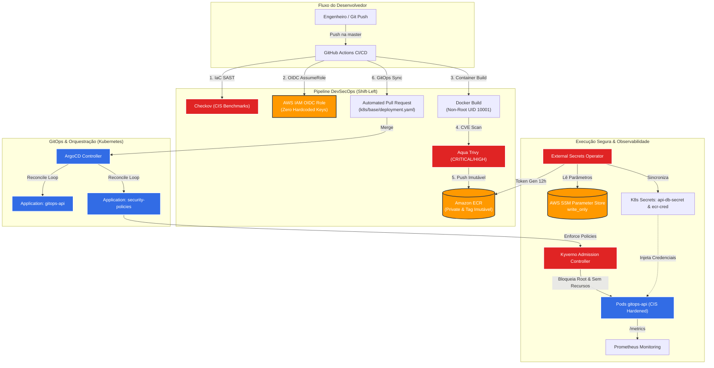

# Enterprise GitOps & DevSecOps Cloud Platform

[](https://github.com/mdhenriques/gitops-lab/actions/workflows/deploy.yaml)
[](LICENSE)
[](https://kubernetes.io)
[](https://www.terraform.io)
[](https://aws.amazon.com)

Ambiente completo de entrega contínua (**GitOps**) e segurança integrada (**DevSecOps**), desenhado seguindo os princípios de menor privilégio, segredos efêmeros, imutabilidade de imagens e validação contínua de políticas de admissão (*Policy-as-Code*).

---

## 🏛️ Arquitetura da Solução

O fluxo conecta a nuvem pública (**AWS**), esteiras de automação (**GitHub Actions**) e orquestração de containers (**Kubernetes & ArgoCD**):



---

## 💡 Decisões de Engenharia & Diferenciais de Segurança

| Domínio | Abordagem Tradicional (Anti-padrão) | Abordagem Deste Projeto (Padrão Enterprise) |
| :--- | :--- | :--- |
| **Autenticação CI/CD** | Chaves estáticas `AWS_ACCESS_KEY_ID` salvas nos Secrets do GitHub. | **AWS IAM OIDC Federation:** Autenticação sem chaves de longa duração, usando claims de repositório imutáveis. |
| **Armazenamento de Segredos** | Senhas gravadas em texto claro no `terraform.tfstate`. | **`ephemeral` + `value_wo`:** Senhas sensíveis geradas dinamicamente no SSM sem persistência no state do Terraform. *(Trade-off: credencial estática IAM usada apenas para viabilizar o lab local Kind; veja seção de Trade-offs).* |
| **Token do ECR no K8s** | CronJob manual executando script bash ou secrets estáticos expirando em 12h. | **ESO ECRAuthorizationToken Generator:** O operador nativo renova os tokens a cada 30m de forma totalmente autônoma. |
| **Ciclo de Atualização** | O bot de CI/CD commita diretamente na branch `master`. | **Automated Pull Requests:** A pipeline abre uma branch rolante com PR para auditoria e controle de merge. |
| **Segurança no Pipeline** | Build e deploy direto sem checagem de vulnerabilidades. | **Shift-Left Security:** Varredura estática de IaC com **Checkov** e varredura de CVEs de container com **Aqua Trivy**. |
| **Segurança de Runtime** | Containers rodando como `root` com privilégios padrão. | **Kyverno Policy-as-Code:** Bloqueio no Admission Webhook para containers sem limits ou tentando rodar como root. |
| **Observabilidade** | Probes cegas ou liveness reiniciando pod em falha de dependência. | **Separação estrita Liveness (`/healthz`) vs. Readiness (`/readyz`)** + **Métricas OpenMetrics/Prometheus** (`/metrics`). |

---

## ⚖️ Trade-offs Arquiteturais: Laboratório vs. Produção Enterprise

Este projeto foi construído para ser 100% reproduzível localmente via **Kind** com custos de nuvem virtualmente nulos. Para manter esse equilíbrio, algumas decisões conscientes foram tomadas:

| Componente | Implementação Neste Lab (Kind) | Implementação Enterprise (AWS EKS) | Justificativa do Trade-off |
| :--- | :--- | :--- | :--- |
| **Autenticação K8s ➔ AWS** | `aws_iam_access_key` com menor privilégio armazenada em Secret local. | **EKS Pod Identity** ou **IRSA (IAM Roles for Service Accounts)**. | Clusters locais fora da AWS não possuem o provedor OIDC nativo do EKS. Em produção, chaves estáticas do ESO são 100% eliminadas via IRSA. |
| **Persistência do Prometheus** | `persistentVolume: false` (Armazenamento efêmero em memória). | **EBS CSI Driver** ou **Amazon Managed Prometheus (AMP)**. | Elimina custos com volumes EBS e dependência de provisioners locais no Kind, mantendo o lab leve e rápido para inicializar. |
| **Segredos no Terraform State** | Parâmetros SSM blindados via `value_wo` e senhas efêmeras. | Parâmetros SSM blindados + AWS Secrets Manager com KMS CMK dedicado. | O SSM Standard Parameter Store atende com perfeição e sem custos adicionais ao propósito de injeção segura de variáveis. |

---

## 🛠️ Stack Tecnológica

- **Cloud Provider:** AWS (ECR, SSM Parameter Store, IAM OIDC, S3 Backend com Lock Nativo)
- **Infrastructure as Code (IaC):** Terraform >= 1.11 (HCL modular com stack bootstrap separado)
- **Container & Runtime:** Docker (python:3.11-slim, non-root UID 10001), Kubernetes v1.30+ (Kind)
- **GitOps Engine:** ArgoCD (Padrão declarativo com auto-heal e prune)
- **Segurança & Políticas:** Checkov, Aqua Trivy, Kyverno Admission Controller, External Secrets Operator (ESO)
- **Aplicação & Observabilidade:** Python 3.11, FastAPI, Uvicorn, Prometheus Instrumentator, Structured JSON Logs

---

## 🚀 Como Reproduzir o Ambiente Localmente

### 1. Pré-requisitos
- [Docker](https://docs.docker.com/get-docker/) e [Kind](https://kind.sigs.k8s.io/) instalados
- [Terraform](https://developer.hashicorp.com/terraform/install) >= 1.11
- [kubectl](https://kubernetes.io/docs/tasks/tools/) e [Helm](https://helm.sh/)
- Conta na AWS com permissões para criar recursos IAM, SSM e ECR

### 2. Provisionamento da Infraestrutura AWS
```bash
# 1. Provisionar o Bucket de Estado S3 com Hardening (State Bootstrap)
cd terraform/bootstrap
terraform init && terraform apply

# 2. Provisionar os recursos principais (ECR, SSM, IAM OIDC Role)
cd ..
terraform init && terraform apply
```

> [!NOTE]
> O stack de bootstrap cria o bucket S3 do zero de forma declarativa. Caso você já possua um bucket pré-existente na sua conta AWS que deseje reutilizar, execute antes do apply: `terraform import aws_s3_bucket.terraform_state <nome-do-bucket>`.

### 3. Inicialização do Cluster Kubernetes e Ferramentas Base
```bash
# 1. Criar o cluster Kind multi-node
kind create cluster --config kind-config.yaml --name gitops-lab

# 2. Instalar o External Secrets Operator (versao fixada v2.12.0)
helm repo add external-secrets https://charts.external-secrets.io
helm repo update
helm install external-secrets external-secrets/external-secrets \
  --version 2.12.0 \
  -n external-secrets --create-namespace \
  -f k8s/eso-values.yaml

# 3. Instalar o Kyverno Admission Controller (versao fixada 3.9.1)
helm repo add kyverno https://kyverno.github.io/kyverno/
helm repo update
helm install kyverno kyverno/kyverno \
  --version 3.9.1 \
  -n kyverno --create-namespace

# 4. Instalar o ArgoCD (versao fixada v3.5.5)
kubectl create namespace argocd
kubectl apply -n argocd -f https://raw.githubusercontent.com/argoproj/argo-cd/v3.5.5/manifests/install.yaml
```

### 4. Configuração das Credenciais do ESO (One-time Bootstrap)
Obtenha as credenciais geradas pelo Terraform e crie os secrets nos namespaces necessários:
```bash
ESO_KEY=$(terraform output -raw eso_access_key_id)
ESO_SECRET=$(terraform output -raw eso_secret_access_key)

# Criar no namespace do operador e no namespace default
for ns in external-secrets default; do
  kubectl create secret generic aws-secret \
    --from-literal=access-key-id="$ESO_KEY" \
    --from-literal=secret-access-key="$ESO_SECRET" \
    -n $ns
done
```

### 5. Ativar as Aplicações no ArgoCD
```bash
# Aplica os manifestos declarativos das aplicações, políticas e monitoramento
kubectl apply -f argocd/application.yaml
kubectl apply -f argocd/security-policies-app.yaml
kubectl apply -f argocd/monitoring-app.yaml
```

---

## 🔍 Validação e Testes Práticos

### Testando a Resiliência das Políticas de Segurança (Kyverno)
Tente executar um container padrão que viole as regras de não-root ou de ausência de limites de recursos:
```bash
kubectl run rogue-pod --image=nginx -n default
```
**Resultado esperado:**
```text
Error from server: admission webhook "validate.kyverno.svc-fail" denied the request:
resource Pod/default/rogue-pod was blocked due to the following policies:
- check-privilege-escalation: Escalada de privilégios é proibida!
- check-run-as-non-root: Containers devem rodar como non-root!
- require-resources: É obrigatório definir limites de CPU e Memória!
```

### Testando a API e Observabilidade
```bash
# Encaminhar porta da API
kubectl port-forward svc/gitops-api-svc 8080:80 -n default

# 1. Consultar endpoint com segredo seguro injetado via SSM
curl http://localhost:8080/

# 2. Consultar métricas do Prometheus
curl http://localhost:8080/metrics
```

---

## 📄 Licença
Distribuído sob a licença MIT. Veja `LICENSE` para mais informações.
