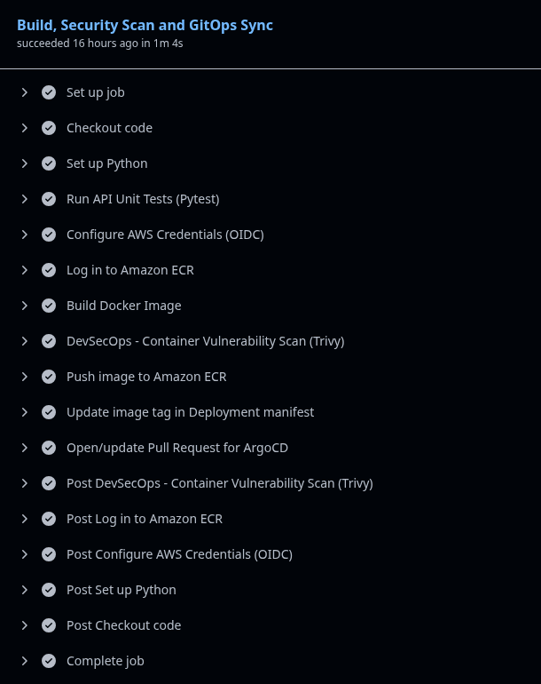
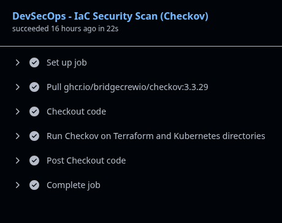

<p align="right">
  <b>🇬🇧 English</b> • <a href="README.pt-BR.md">🇧🇷 Português</a>
</p>

# Enterprise GitOps & DevSecOps Cloud Platform

[](https://github.com/mdhenriques/gitops-lab/actions/workflows/deploy.yaml)
[](LICENSE)
[](https://kubernetes.io)
[](https://www.terraform.io)
[](https://aws.amazon.com)
[](https://argoproj.github.io/cd/)
[](https://kyverno.io/)
[](https://www.checkov.io/)

A production-grade cloud native platform engineered to demonstrate **Enterprise GitOps, Shift-Left DevSecOps, and Zero-Trust Kubernetes Governance**. 

Designed to eliminate common cloud anti-patterns (such as static credentials in CI/CD, plain-text secrets in Terraform state, and unconstrained container runtimes), this platform implements a fully declarative, auditable, and automated delivery lifecycle connecting **AWS**, **GitHub Actions**, **ArgoCD**, **Kyverno**, and **Prometheus**.

---

## 📑 Table of Contents

- [🏛️ Solution Architecture](#️-solution-architecture)
- [🔄 End-to-End System Workflow](#-end-to-end-system-workflow)
- [🧠 Deep-Dive Engineering Decisions & "The Why"](#-deep-dive-engineering-decisions--the-why)
  - [1. Keyless CI/CD via AWS IAM OIDC Federation](#1-keyless-cicd-via-aws-iam-oidc-federation)
  - [2. Shift-Left Security Pipeline (Checkov, Trivy, Pytest)](#2-shift-left-security-pipeline-checkov-trivy-pytest)
  - [3. Pull-Based GitOps Delivery vs. Push-Based CI/CD](#3-pull-based-gitops-delivery-vs-push-based-cicd)
  - [4. Zero-Trust Runtime & Policy-as-Code (Kyverno)](#4-zero-trust-runtime--policy-as-code-kyverno)
  - [5. State Sanitization & Dynamic ECR Token Generation (ESO)](#5-state-sanitization--dynamic-ecr-token-generation-eso)
  - [6. Defense-in-Depth Network Isolation](#6-defense-in-depth-network-isolation)
  - [7. Resilient Health Probes & OpenMetrics Telemetry](#7-resilient-health-probes--openmetrics-telemetry)
- [💡 Architectural Comparison (Anti-patterns vs. Enterprise Standard)](#-architectural-comparison-anti-patterns-vs-enterprise-standard)
- [⚖️ Trade-offs: Local Lab vs. AWS Production](#️-trade-offs-local-lab-vs-aws-production)
- [📁 Repository Structure](#-repository-structure)
- [🛠️ Technology Stack](#️-technology-stack)
- [🚀 Local Reproduction Guide (Runbooks)](#-local-reproduction-guide-runbooks)
- [📄 License](#-license)

---

## 🏛️ Solution Architecture

The platform architecture bridges managed cloud services on **AWS**, an automated security-first CI/CD pipeline in **GitHub Actions**, and a hardened multi-node **Kubernetes** cluster synchronized declaratively via **ArgoCD**:

<p align="center">
  
</p>

---

## 🔄 End-to-End System Workflow

Every code change follows a rigorous, automated promotion lifecycle from pull request to production runtime:

```
[Developer Push] 
       │
       ▼
[GitHub Actions CI] ──► 1. Unit Tests (Pytest fail-fast)
       │              ► 2. IaC Security Scan (Checkov SAST)
       │              ► 3. Keyless Auth (AWS STS via GitHub OIDC)
       │              ► 4. Docker Build & Image CVE Scan (Aqua Trivy)
       │              ► 5. Push to AWS ECR (Immutable SHA tag)
       │              ► 6. Automated PR updating k8s/base/deployment.yaml
       ▼
[Merge to Master]
       │
       ▼
[ArgoCD Sync Loop] ──► 7. Detects Git drift & pulls target manifest
       │              ► 8. Submits workload to Kubernetes API Server
       ▼
[Admission Webhook] ──► 9. Kyverno validates: Non-Root, No Privilege Escalation, Resource Limits
       │
       ├─── [Violation] ──► REJECTED (Pod blocked before scheduling)
       └─── [Approved]  ──► Pod scheduled to worker node
                               │
                               ▼
[External Secrets]  ──► 10. Refreshes AWS ECR docker-config token every 30m
                     ► 11. Pulls database credentials from AWS SSM Parameter Store
                               │
                               ▼
[Runtime Monitoring] ─► 12. Prometheus scrapes /metrics + verifies separated /healthz & /readyz
```

---

## 🧠 Deep-Dive Engineering Decisions & "The Why"

### 1. Keyless CI/CD via AWS IAM OIDC Federation

* **The Problem:** Storing long-lived `AWS_ACCESS_KEY_ID` and `AWS_SECRET_ACCESS_KEY` in GitHub Secrets represents a high-severity security risk. Static keys do not expire automatically, lack context-based constraints, and if leaked, grant broad, untraceable access to the AWS account.
* **The Engineering Solution:** Configured an **OpenID Connect (OIDC) Identity Provider** between GitHub Actions and AWS IAM. The pipeline uses `aws-actions/configure-aws-credentials` to request short-lived (15–60 min) STS credentials via `sts:AssumeRoleWithWebIdentity`.
* **Security Hardening:** The IAM Role trust policy strictly evaluates immutable GitHub repository claims:
  ```json
  "Condition": {
    "StringEquals": {
      "token.actions.githubusercontent.com:aud": "sts.amazonaws.com",
      "token.actions.githubusercontent.com:sub": "repo:mdhenriques@103260127/gitops-lab@1416272098:ref:refs/heads/master"
    }
  }
  ```
  Even if the repository name is spoofed or forked, only the exact cryptographic repository and account IDs can assume the deployment role.

<p align="center">
  
</p>

---

### 2. Shift-Left Security Pipeline (Checkov, Trivy, Pytest)

* **The Problem:** Catching infrastructure vulnerabilities or insecure base images in production is orders of magnitude more expensive and hazardous than catching them during code review.
* **The Engineering Solution:** Implemented a three-tiered shift-left validation gate directly in the GitHub Actions runner:
  1. **Unit & Contract Testing:** `pytest apps/api/test_main.py` executes before any packaging, guaranteeing functional correctness.
  2. **Infrastructure as Code (IaC) SAST:** `checkov` analyzes all Terraform modules and Kubernetes manifests for security misconfigurations (e.g., exposed ports, missing encryption, wildcards in IAM policies).
  3. **Container CVE Vulnerability Scanning:** `aquasecurity/trivy-action` scans the freshly built Docker image for high and critical OS/package vulnerabilities before allowing the image push to AWS ECR.

<p align="center">
  
</p>

---

### 3. Pull-Based GitOps Delivery vs. Push-Based CI/CD

* **The Problem:** In traditional push-based deployment models (e.g., CI script running `kubectl apply`), the CI runner requires cluster administrative credentials (`kubeconfig`). This expands the cluster's attack surface to the CI infrastructure and fails to detect manual configuration drift caused by cluster operators.
* **The Engineering Solution:** Adopted a **Pull-based GitOps engine (ArgoCD)** residing inside the cluster. The CI workflow builds the container image with an immutable Git commit hash tag, then opens an automated Pull Request updating `k8s/base/deployment.yaml`. Once merged, ArgoCD reconciles the cluster state against Git.
* **Governance via ArgoCD `AppProject`:** Workloads are isolated within a dedicated `gitops-lab-project` that enforces:
  - Whitelisting only `https://github.com/mdhenriques/gitops-lab.git` as a valid source repository.
  - Restricting deployment destinations strictly to the `production` namespace.
  - Blocking unauthorized creation of cluster-scoped resources.

<p align="center">
  
</p>

<p align="center">
  
</p>

---

### 4. Zero-Trust Runtime & Policy-as-Code (Kyverno)

* **The Problem:** Default Kubernetes clusters do not prevent developers from accidentally deploying containers running as `root`, mounting writable file systems, or consuming unlimited cluster memory and CPU, leading to "noisy neighbor" cluster starvation.
* **The Engineering Solution:** Enforced declarative **Admission Controller Policies** via **Kyverno** operating in `Enforce` mode. Any resource submitted to the API server is inspected before being persisted to `etcd`:
  - **`disallow-root-and-privileged`:** Enforces `runAsNonRoot: true`, numeric UID (10001), drops all Linux capabilities (`drop: ["ALL"]`), and prevents privilege escalation (`allowPrivilegeEscalation: false`).
  - **`require-resources`:** Mandates that every container explicitly define `requests` and `limits` for both CPU and memory.
  - **Container Hardening:** The API image builds with a non-root user and mounts `readOnlyRootFilesystem: true`, neutralizing common script-injection and file modification attacks.

<p align="center">
  
</p>

---

### 5. State Sanitization & Dynamic ECR Token Generation (ESO)

* **The Problem with Secrets in IaC:** Terraform historically stores all inputs and outputs in plain text inside `terraform.tfstate`. If a database password is generated or passed to Terraform, it leaks into state storage.
* **The Problem with ECR Authentication:** AWS ECR authentication tokens expire every 12 hours. Traditional solutions rely on unmaintainable Bash CronJobs running `aws ecr get-login-password` to patch Kubernetes secrets.
* **The Engineering Solution:**
  1. **Terraform 1.11+ `ephemeral` & `value_wo`:** Secrets are generated using `ephemeral.random_password` and pushed to AWS SSM Parameter Store using the write-only attribute `value_wo`. The password is transmitted directly to AWS and never written to the local or remote `.tfstate`.
  2. **External Secrets Operator (ESO) + ECR Generator:** Utilized native ESO `ClusterGenerator` (`kind: ECRAuthorizationToken`) coupled with an `ExternalSecret`. The operator communicates directly with AWS STS/ECR, refreshing the Docker authentication token every 30 minutes seamlessly without custom scripts or CronJobs.

---

### 6. Defense-in-Depth Network Isolation

* **The Problem:** Kubernetes networking follows an open by default model: any pod in any namespace can reach any other pod, exposing backend services to lateral movement attacks if an unrelated container is compromised.
* **The Engineering Solution:** Implemented a zero-trust `NetworkPolicy` on the `production` namespace:
  - **Default Ingress Restriction:** Blocks all incoming traffic except explicit HTTP traffic routed to port 8000 and metrics scraping from the `monitoring` namespace.
  - **Targeted Egress Whitelisting:** Permits DNS resolution (`kube-system` UDP 53) and outbound HTTPS (port 443) exclusively for AWS SSM and ECR API communication, blocking arbitrary external network calls.

---

### 7. Resilient Health Probes & OpenMetrics Telemetry

* **The Problem:** Conflating Liveness and Readiness probes is a frequent cause of cascading failures in distributed systems. If a database is slow and a Liveness probe fails, Kubernetes kills the pod, exacerbating traffic load on surviving replicas.
* **The Engineering Solution:**
  - **Liveness Probe (`/healthz`):** Verifies strictly that the Python process and event loop are responsive. It does not check downstream dependencies.
  - **Readiness Probe (`/readyz`):** Verifies that configuration parameters, SSM secrets, and network dependencies are available. If a dependency falters, traffic is diverted without killing the container.
  - **Observability via Prometheus:** Integrated `prometheus-fastapi-instrumentator` exposing golden signals (HTTP request rate, error rate, and request duration percentiles) on `/metrics`.

<p align="center">
  
</p>

---

## 💡 Architectural Comparison (Anti-patterns vs. Enterprise Standard)

| Domain | Traditional Approach (Anti-pattern) | This Project's Approach (Enterprise Standard) | Architectural Benefit |
| :--- | :--- | :--- | :--- |
| **CI/CD Authentication** | Static `AWS_ACCESS_KEY_ID` saved in GitHub Secrets. | **AWS IAM OIDC Federation:** Keyless authentication using immutable GitHub repository claims. | Zero secret rotation overhead; eliminates key leakage blast radius. |
| **Secrets in IaC** | Passwords committed or stored in plain text in `terraform.tfstate`. | **`ephemeral` + `value_wo`:** Sensitive passwords sent to AWS SSM without persisting in state files. | State file can be audited and shared without exposing production secrets. |
| **ECR Image Pull Auth** | Custom CronJob script patching Kubernetes `dockerconfigjson` every 12h. | **ESO `ECRAuthorizationToken` Generator:** Native operator auto-refreshes auth token every 30m. | Eliminates fragile shell scripts; natively reconciled by Kubernetes operator. |
| **GitOps Deployment** | CI runner executes `kubectl apply` using cluster admin `kubeconfig`. | **Pull-Based GitOps (ArgoCD):** Cluster pulls changes; automated PRs update image tags. | Cluster credentials never leave the cluster; automatic drift detection and auto-healing. |
| **Pipeline Security** | Unverified code built and deployed directly to registry. | **Shift-Left Security:** Pytest unit tests, Checkov IaC scanning, and Trivy container CVE scans. | Bugs and compliance violations blocked at commit time before packaging. |
| **Runtime Hardening** | Containers running as `root` with writable file systems and full capabilities. | **CIS Hardening & Kyverno:** `readOnlyRootFilesystem`, non-root UID 10001, capability drops. | Mitigates container breakout attacks and file tampering at runtime. |
| **Cluster Governance** | All applications deployed into ArgoCD `default` project without restrictions. | **Dedicated ArgoCD `AppProject`:** Whitelisted Git repos, target namespaces, and cluster resources. | Enforces strict multi-tenancy boundaries and prevents resource hijacking. |
| **Cost Optimization** | ECR repository storing images indefinitely without retention rules. | **ECR Lifecycle Policy:** Retains strictly the 10 most recent images; purges older builds. | Predictable, near-zero AWS storage costs (**FinOps** best practice). |
| **Observability** | Single health probe checking both server and database availability. | **Separated Liveness (`/healthz`) vs. Readiness (`/readyz`)** + **Prometheus Metrics**. | Prevents cascading restart storms; provides granular golden-signal telemetry. |

---

## ⚖️ Trade-offs: Local Lab vs. AWS Production

This platform was engineered to be **100% reproducible on a local developer workstation** using **Kind** while interfacing with real AWS cloud infrastructure at virtually zero cost. To balance realism with cost efficiency, the following deliberate design trade-offs were made:

| Component | Implementation in this Lab (Kind) | Enterprise Production (AWS EKS) | Trade-off Rationale |
| :--- | :--- | :--- | :--- |
| **Cluster IAM Auth** | `aws_iam_access_key` with least-privilege stored in Kubernetes Secret. | **EKS Pod Identity** or **IRSA (IAM Roles for Service Accounts)**. | Local clusters outside AWS lack the native EKS OIDC identity issuer. In production EKS, static ESO credentials are 100% replaced by IAM service account annotations. |
| **Storage Persistence** | Ephemeral storage (`persistentVolume: false`) for Prometheus. | **EBS CSI Driver** or **Amazon Managed Prometheus (AMP)**. | Eliminates monthly EBS volume charges and dynamic provisioner overhead, keeping the local cluster fast and lightweight. |
| **DevSecOps Scanners** | Informative mode execution (`soft_fail: true` / `exit-code: 0`). | Strict pipeline blocking (*Hard-fail*) with compliance gates. | Allows continuous auditing without breaking pipeline builds for enterprise policies that incur extra AWS costs (e.g., dedicated KMS CMK, S3 Cross-Region Replication, and S3 Access Logging). |
| **Parameter Storage** | AWS Systems Manager (SSM) Standard Parameter Store. | AWS Secrets Manager with dedicated KMS Customer Managed Keys (CMK). | SSM Standard Parameter Store flawlessly fulfills secure variable injection with zero added AWS billing. |

> [!NOTE]
> **FinOps & Compliance Posture:**
> Static security scanners (**Checkov**) and container scanners (**Aqua Trivy**) operate intentionally in **informative mode** (`soft_fail: true`). Decisions such as omitting S3 Access Logging or Cross-Region Replication on the lab state bucket are deliberate **FinOps** choices: they maintain zero recurring costs while keeping the security scan audit trail transparent.

---

## 📁 Repository Structure

```text
├── .github/workflows/
│   └── deploy.yaml              # GitHub Actions CI/CD (Pytest, Checkov, Trivy, OIDC, PR bot)
├── apps/api/
│   ├── Dockerfile               # Hardened multi-stage container (non-root UID 10001, python:3.11-slim)
│   ├── main.py                  # FastAPI application with Prometheus instrumentator & health probes
│   ├── test_main.py             # Automated unit tests for API endpoints and metrics
│   ├── requirements.txt         # Runtime application dependencies
│   └── requirements-dev.txt     # Development and testing dependencies (pytest, httpx)
├── argocd/
│   ├── app-project.yaml         # ArgoCD governance policy (repository & destination whitelisting)
│   ├── application.yaml         # Primary GitOps application managing k8s/base/ workloads
│   ├── monitoring-app.yaml      # Declarative Prometheus stack integration
│   └── security-policies-app.yaml # GitOps deployment for Kyverno admission policies
├── k8s/
│   ├── base/
│   │   ├── api-external-secret.yaml     # ESO sync between AWS SSM and Kubernetes Secret
│   │   ├── aws-secret-store.yaml        # ClusterSecretStore provider definition
│   │   ├── deployment.yaml              # Production workload deployment (hardened securityContext)
│   │   ├── ecr-cluster-generator.yaml   # ESO ClusterGenerator for AWS ECR authentication
│   │   ├── ecr-pull-external-secret.yaml # Auto-renewed docker-registry secret
│   │   ├── network-policy.yaml          # Zero-trust network isolation for production namespace
│   │   └── service.yaml                 # ClusterIP service definition
│   └── eso-values.yaml                  # Helm configuration for External Secrets Operator
├── policies/kyverno/
│   ├── disallow-root.yaml       # Admission policy enforcing non-root & no privilege escalation
│   └── require-resources.yaml   # Admission policy enforcing mandatory CPU/Memory requests & limits
├── terraform/
│   ├── bootstrap/               # Isolated stack for S3 remote backend with AES-256 & versioning
│   │   └── main.tf
│   ├── main.tf                  # AWS ECR (lifecycle policy), SSM Parameter, IAM OIDC Role & Policies
│   └── variables.tf             # Parameterized configurations with typed variables
├── docs/assets/                 # Architecture diagrams, observability graphs & pipeline screenshots
├── kind-config.yaml             # Multi-node Kubernetes cluster configuration (1 control-plane, 2 workers)
└── README.md                    # Platform documentation and engineering runbooks
```

---

## 🛠️ Technology Stack

- **Cloud Infrastructure:** AWS (ECR with Lifecycle Policy, SSM Parameter Store, IAM OIDC Federation, S3 Remote State Backend)
- **Infrastructure as Code (IaC):** Terraform >= 1.11 (Modular HCL, write-only SSM parameters, state bootstrap)
- **Containerization & Runtime:** Docker, Kubernetes v1.30+ (Kind multi-node: 1 control-plane, 2 workers)
- **GitOps Continuous Delivery:** ArgoCD v3.5.5 (AppProject governance, automated self-healing, declarative pruning)
- **Policy-as-Code & Security:** Kyverno v3.9.1 (Admission Controller Webhooks), External Secrets Operator v2.12.0, Checkov (IaC SAST), Aqua Trivy (Container CVE Scanner)
- **Application & Observability:** Python 3.11, FastAPI, Uvicorn, Pytest, Prometheus, OpenMetrics, Structured JSON Logging

---

## 🚀 Local Reproduction Guide (Runbooks)

If you wish to deploy and test the entire platform on your local machine, follow the runbooks below:

### ⚠️ Step 0: Mandatory Fork (Do not use direct `git clone`)

> [!WARNING]
> **Running `git clone` directly from this upstream repository will NOT work for your lab!**
> 
> This project operates under the **GitOps and Continuous Automation (CI/CD)** model. For the end-to-end cycle to work:
> - You need write permissions so the GitHub Actions pipeline can build container images and open automated Pull Requests.
> - The AWS IAM Role via OIDC in your AWS account will only authorize executions originating from your own repository.
> - Your local ArgoCD instance needs to monitor and reconcile a repository under your full control.
> 
> **Mandatory step-by-step:**
> 1. Click the **Fork** button (top right of this GitHub page) to create a copy in your account.
> 2. Clone **your fork** to your local machine:
>    ```bash
>    git clone https://github.com/YOUR_USER/gitops-lab.git
>    cd gitops-lab
>    ```
> 3. Update the URLs across the ArgoCD manifests to point to your fork:
>    ```bash
>    sed -i 's/mdhenriques/YOUR_USER/g' argocd/*.yaml
>    ```
> 4. Configure the OIDC claim in [terraform/variables.tf](terraform/variables.tf) (`github_oidc_sub` variable):  
>    GitHub Actions requires the immutable ID format (`repo:USER@ID/REPO@ID:ref:refs/heads/master`). To retrieve the numeric IDs of your account and forked repository, run:
>    ```bash
>    # 1. Retrieve your GitHub account numeric ID:
>    curl -s https://api.github.com/users/YOUR_USER | grep -m1 '"id":'
>    
>    # 2. Retrieve your gitops-lab repository numeric ID:
>    curl -s https://api.github.com/repos/YOUR_USER/gitops-lab | grep -m1 '"id":'
>    ```
>    Update the value in `terraform/variables.tf`:
>    ```hcl
>    variable "github_oidc_sub" {
>      default = "repo:YOUR_USER@YOUR_USER_ID/gitops-lab@YOUR_REPO_ID:ref:refs/heads/master"
>    }
>    ```

---

### 1. Prerequisites
- [Docker](https://docs.docker.com/get-docker/) and [Kind](https://kind.sigs.k8s.io/) installed
- [Terraform](https://developer.hashicorp.com/terraform/install) >= 1.11
- [kubectl](https://kubernetes.io/docs/tasks/tools/) and [Helm](https://helm.sh/)
- AWS account with permissions to provision IAM, SSM, and ECR resources

---

### 2. AWS Infrastructure Provisioning
```bash
# 1. Provision S3 State Bucket with Hardening (State Bootstrap)
cd terraform/bootstrap
terraform init && terraform apply -auto-approve

# 2. Provision core resources (ECR with Lifecycle Policy, SSM, IAM OIDC Role)
cd ..
terraform init && terraform apply -auto-approve
```

> [!NOTE]
> The bootstrap stack creates the S3 bucket declaratively from scratch. If you already have an existing bucket in your AWS account that you want to reuse, run before applying: `terraform import aws_s3_bucket.terraform_state <bucket-name>`.

---

### 3. Kubernetes Cluster & Base Tooling Initialization
```bash
# 1. Create Kind multi-node cluster (1 control-plane and 2 workers)
kind create cluster --config kind-config.yaml --name gitops-lab

# 2. Install External Secrets Operator (pinned version v2.12.0)
helm repo add external-secrets https://charts.external-secrets.io
helm repo update
helm install external-secrets external-secrets/external-secrets \
  --version 2.12.0 \
  -n external-secrets --create-namespace \
  -f k8s/eso-values.yaml

# 3. Install Kyverno Admission Controller (pinned version 3.9.1)
helm repo add kyverno https://kyverno.github.io/kyverno/
helm repo update
helm install kyverno kyverno/kyverno \
  --version 3.9.1 \
  -n kyverno --create-namespace

# 4. Install ArgoCD (pinned version v3.5.5)
kubectl create namespace argocd
kubectl apply --server-side -n argocd -f https://raw.githubusercontent.com/argoproj/argo-cd/v3.5.5/manifests/install.yaml
```

---

### 4. ESO Credentials Configuration (One-time Bootstrap)
Retrieve credentials generated by Terraform and create secrets in the target namespaces:
```bash
# Create application production namespace
kubectl create namespace production

# Retrieve credentials from terraform stack output
ESO_KEY=$(terraform -chdir=terraform output -raw eso_access_key_id)
ESO_SECRET=$(terraform -chdir=terraform output -raw eso_secret_access_key)

# Create the Secret in both operator and application namespaces
for ns in external-secrets production; do
  kubectl create secret generic aws-secret \
    --from-literal=access-key-id="$ESO_KEY" \
    --from-literal=secret-access-key="$ESO_SECRET" \
    -n $ns
done
```

---

### 5. Deploy ArgoCD Applications
```bash
# 1. Apply AppProject with governance and security constraints
kubectl apply -f argocd/app-project.yaml

# 2. Apply declarative applications (Workload, Policies, and Monitoring)
kubectl apply -f argocd/application.yaml
kubectl apply -f argocd/security-policies-app.yaml
kubectl apply -f argocd/monitoring-app.yaml
```

> [!TIP]
> If running for the first time in a fresh AWS account with an empty ECR repository, trigger the **CI/CD - Build and GitOps Sync** workflow in GitHub Actions to build the initial image and approve the automated Pull Request opened by the bot.

---

### 6. Verification and Hands-on Testing

#### Testing Kyverno Policy Enforcement
Attempt to run an unconstrained, root container in the `production` namespace:
```bash
kubectl run rogue-pod --image=nginx -n production
```
Expected response:
```text
Error from server: admission webhook "validate.kyverno.svc-fail" denied the request: 
resource Pod/production/rogue-pod was blocked due to the following policies:
disallow-root-and-privileged: Containers must run as non-root.
require-resources: CPU and Memory limits and requests are required.
```

#### Testing the API & Secure Secrets Injection
```bash
kubectl port-forward svc/gitops-api-svc 8000:80 -n production
```
- Access `http://localhost:8000/`: Verifies dynamic SSM injection without exposing credentials.
- Access `http://localhost:8000/healthz` and `http://localhost:8000/readyz`: Tests probe segregation.
- Access `http://localhost:8000/metrics`: Exposes Prometheus metrics in OpenMetrics format.

#### Accessing Dashboards
- **ArgoCD (`http://localhost:8080`):**
  ```bash
  kubectl port-forward svc/argocd-server -n argocd 8080:443
  kubectl get secret argocd-initial-admin-secret -n argocd -o jsonpath="{.data.password}" | base64 -d && echo ""
  ```
- **Prometheus (`http://localhost:9090`):**
  ```bash
  kubectl port-forward svc/prometheus-server -n monitoring 9090:80
  ```

#### Running Unit Tests Locally
```bash
python3 -m venv .venv
source .venv/bin/activate
pip install -r apps/api/requirements.txt -r apps/api/requirements-dev.txt
pytest apps/api/test_main.py -v
```

---

## 📄 License
Distributed under the MIT License. See [LICENSE](LICENSE) for more details.
